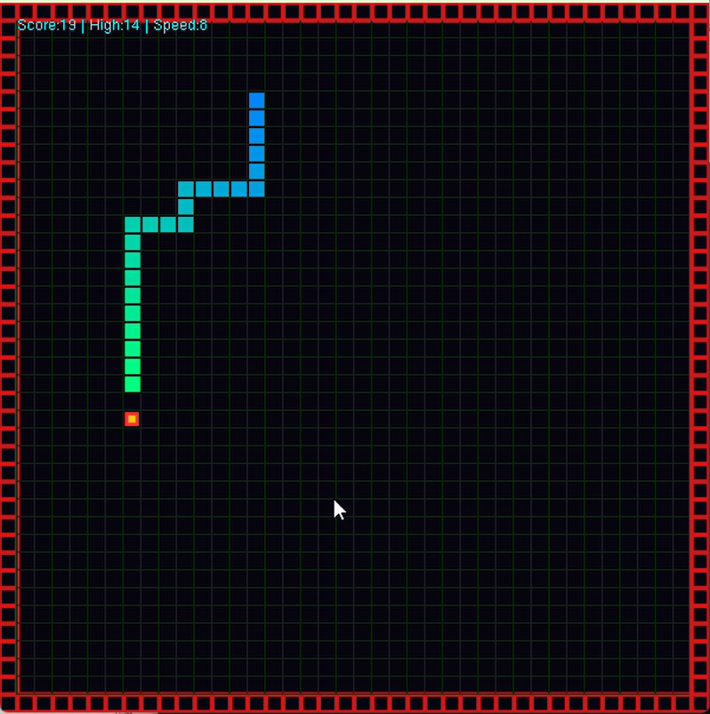
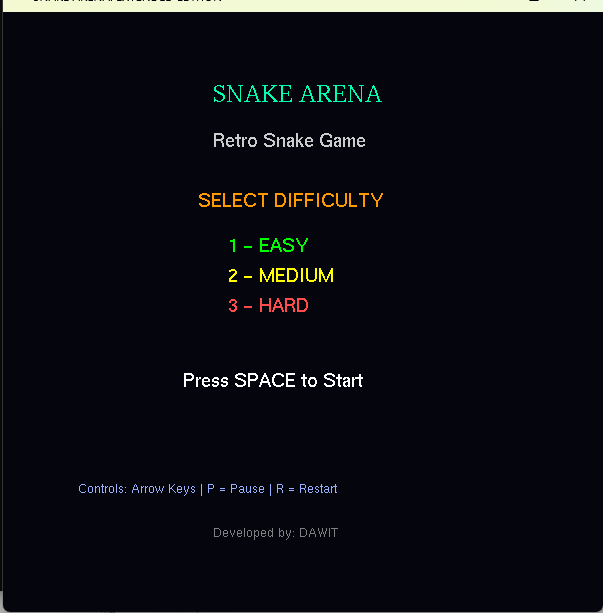

# 🐍 Snake Game using OpenGL (C++)

A simple and interactive **Snake Game** developed using **C++** and **OpenGL (GLUT)**.

This project was created as a graphics programming assignment to demonstrate:

- 2D graphics rendering
- Keyboard interaction
- Collision detection
- Game loop and animation
- Sound effects integration
- Score and high score system

---

# 🎮 Features

✅ Classic Snake Gameplay  
✅ Real-time Keyboard Controls  
✅ Score Counter  
✅ High Score Saving System  
✅ Sound Effects (`hiss.wav`, `hit.wav`)  
✅ Game Over Screen  
✅ Pause Functionality  
✅ Grid-based Movement  
✅ Built with OpenGL GLUT  

---

# 🛠️ Technologies Used

- C++
- OpenGL
- GLUT / FreeGLUT
- Code::Blocks IDE

---

# 📂 Project Structure

```bash
SnakeGame/
│
├── main.cpp
├── grid.cpp
├── grid.h
├── hiss.wav
├── hit.wav
├── highscore.txt
├── game.cbp
├── README.md
│
├── screenshots/
│   ├── gameplay.png
│   └── gameover.png
```

---

# 📸 Screenshots

## 🎮 Gameplay



## 💀 Game Over Screen



---

# 🎯 Controls

| Key | Action |
|-----|--------|
| ↑ | Move Up |
| ↓ | Move Down |
| ← | Move Left |
| → | Move Right |
| P | Pause / Resume |
| R | Restart Game |
| ESC | Exit Game |

---

# 🚀 How to Run

## Method 1 — Using Code::Blocks

1. Open `game.cbp`
2. Build and Run the project
3. Make sure GLUT/OpenGL libraries are installed

---

## Method 2 — Using g++ Compiler

Compile using:

```bash
g++ main.cpp grid.cpp -o game -lfreeglut -lopengl32 -lglu32
```

Run:

```bash
./game
```

---

# 🎮 Gameplay Description

The player controls the snake to collect food while avoiding collisions with walls or itself.

As the snake eats food:

- The score increases
- The snake grows longer
- The game becomes more challenging

The game ends when:

- The snake hits the wall
- The snake collides with itself

---

# 📚 Learning Objectives

This project helped in understanding:

- OpenGL rendering basics
- Event-driven programming
- Game development fundamentals
- Collision handling
- Animation timing using GLUT
- Modular programming in C++

---

# 🔊 Sound Effects

| File | Purpose |
|------|----------|
| `hiss.wav` | Snake movement / food sound |
| `hit.wav` | Collision / game over sound |

---

# ⚠️ Requirements

Before running the project, ensure:

- OpenGL is installed
- GLUT or FreeGLUT is configured
- MinGW compiler is installed (for Windows users)

---

# 💡 Future Improvements

Possible future enhancements:

- Multiple levels
- Obstacles
- Better UI design
- Multiplayer mode
- Background music
- Mobile version

---

# 👩‍💻 Author

Developed by **D**  
Information Technology Student at Dire Dawa University

---

# ⭐ GitHub

If you like this project, give it a ⭐ on GitHub.

